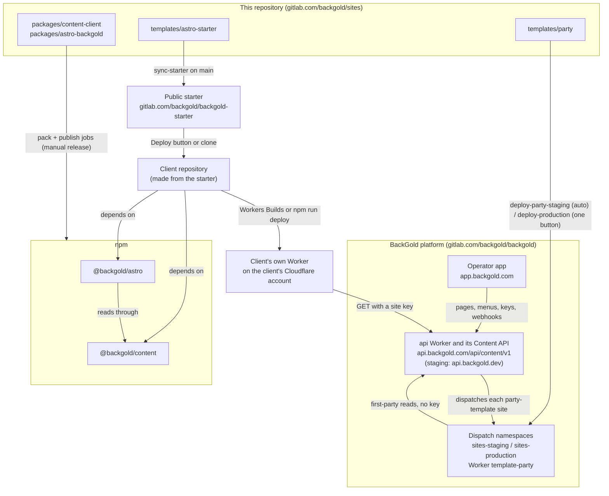

# Building a client site on BackGold

This guide is for engineers on the BackGold team who build websites for
clients, most often with a coding agent (Claude Code or similar) working
beside them. It says which pieces exist, which one to use, how a site talks
to the platform, how it deploys, and what never to do. Every command here
runs as written.

Agents working in this repository also read [`CLAUDE.md`](../CLAUDE.md), the
rule sheet. The README of each package and template is the reference for its
own details; this guide links to them rather than repeating them.

## Which path are you on?

| | Path A: a client site from the public starter | Path B: a site on the party template |
| --- | --- | --- |
| What it is | The client's own Astro site, in the client's own repository, made from the public starter [gitlab.com/backgold/backgold-starter](https://gitlab.com/backgold/backgold-starter). | A site BackGold draws with its hosted party template, `templates/party` in this repository. |
| Where the code lives | The client's repository (GitHub or GitLab). This repository is not involved, except when a fix belongs in a package. | This repository, `templates/party`. One copy of the code serves every site on the template. |
| How the site is set up | A site in **headless** mode in the operator app, read with site keys. | A site made from the template in the operator app (template mode). No keys. |
| How it deploys | As the client's own Cloudflare Worker, from the client's repository. | As the Worker `template-party` in BackGold's Workers for Platforms dispatch namespaces, `sites-staging` and `sites-production`, from this repository's `main`. |
| Read next | [Path A](#path-a-a-client-site-from-the-public-starter) | [Path B](#path-b-a-site-on-the-party-template) |

Pick A when the client wants a design of their own and will own the code.
Pick B when the site should look like the party template and BackGold runs
it. Both paths share everything under [Shared material](#shared-material).

## The pieces

| Piece | Where | What it is |
| --- | --- | --- |
| The BackGold platform | [gitlab.com/backgold/backgold](https://gitlab.com/backgold/backgold) (private) | The api, the operator app and the Content API. Production: app `https://app.backgold.com`, api `https://api.backgold.com`. Staging: app `https://app.backgold.dev`, api `https://api.backgold.dev`. |
| The Content API | `<api>/api/content/v1`, reference at `<api>/api/content/v1/docs` | The read-only API a site gets its pages, menus, entries, events, areas and brand from. The developer guide is [HEADLESS-CONTENT-API.md](HEADLESS-CONTENT-API.md). |
| `@backgold/content` | npm; source `packages/content-client` | The typed, cache-aware client for the Content API, and the `backgold-content types` command. [README](../packages/content-client/README.md). |
| `@backgold/astro` | npm; source `packages/astro-backgold` | The plumbing for an Astro site on Cloudflare Workers: routing, the edge cache, the webhook, preview, redirects, the SEO routes and the components (`Section`, `Area`, `Menu`, `Embed`, `Disclaimer`, …). It reads content with `@backgold/content`. [README](../packages/astro-backgold/README.md). |
| The public starter | `templates/astro-starter` here, mirrored to gitlab.com/backgold/backgold-starter | The thin, restylable site on top of the two packages. Its [README](../templates/astro-starter/README.md) is written for outside users and is the client-facing setup guide. |
| The party template | `templates/party` | The template BackGold runs for state parties. Its `template.json` tells the operator app's composer which layouts it draws. [README](../templates/party/README.md). |
| The contract snapshot | `vendor/backgold-contract` | The Content API's response types, example responses, built-in content types and the template manifest schema, copied from the platform. Private to this workspace; `@backgold/content` bundles what it uses. Never edited by hand. |



## Path A: a client site from the public starter

The client's site is its own repository and its own Cloudflare Worker. BackGold
holds the content; the site reads it through the Content API and draws it with
components the client owns.

### 1. Set up the site in the operator app

In the operator app (production, `https://app.backgold.com`, for a real
client), open **Sites**, choose the client's site, then **Developer**. The site
must be in **headless** mode; the Developer page switches it. That page lists
the five connection steps the starter's README walks through, with each step's
fields: the publishable key, a new secret key, the preview test, the webhook
endpoint, and the domain.

### 2. Make the client's repository

Either:

- **Deploy to Cloudflare.** The button in the
  [public starter's README](https://gitlab.com/backgold/backgold-starter)
  makes a copy of the starter in the client's GitHub or GitLab account,
  creates the Worker and its KV namespace, and asks for `BACKGOLD_SITE_KEY`
  and `SITE_URL`. A site made this way rebuilds and deploys on every push to
  that repository.
- **Clone it** into a repository of the client's:

  ```bash
  git clone https://gitlab.com/backgold/backgold-starter.git <client-site>
  cd <client-site>
  git remote set-url origin <the client's repository URL>
  npm install
  ```

  The public starter's `package.json` names published `^<version>` ranges of
  both packages, so `npm install` works outside this repository.

Never push to gitlab.com/backgold/backgold-starter. It is written only by this
repository's `sync-starter` job, and anything pushed there by hand is
overwritten.

### 3. Configure it

| Name | Where it goes |
| --- | --- |
| `BACKGOLD_SITE_KEY` (`bg_site_pk_…`) | `wrangler.jsonc` → `vars`, committed. It is publishable. |
| `SITE_URL` | `wrangler.jsonc` → `vars`, committed. The site's public address. |
| `BACKGOLD_API_ORIGIN` | `wrangler.jsonc` → `vars`. Leave `https://api.backgold.com` for a production site. |
| `BACKGOLD_SECRET_KEY` (`bg_site_sk_…`) | `npx wrangler secret put BACKGOLD_SECRET_KEY` on the Worker; `.dev.vars` locally. Never committed. |
| `BACKGOLD_WEBHOOK_SECRET` (`whsec_…`) | `npx wrangler secret put BACKGOLD_WEBHOOK_SECRET` on the Worker; `.dev.vars` locally. Never committed. |

Values set only in the Cloudflare dashboard are replaced by the next deploy,
which applies `wrangler.jsonc`'s `vars`. The starter's
[Settings](../templates/astro-starter/README.md#settings) table has every name.

### 4. Build it

Everything the client sees is in `src/`, none of it generated:
`src/layouts/Site.astro` (head, header, menus, areas, footer, legal line),
`src/pages/[...path].astro` (every address), `src/pages/preview.astro`,
`src/components/sections/` with its `index.ts` map, and
`src/styles/site.css`. The starter's
[Restyle it](../templates/astro-starter/README.md#restyle-it) section is the
map. Work in a client repository:

```bash
npm run dev       # Astro's dev server on workerd, reloading as you edit
npm run check     # astro check
npm run types     # write src/backgold.d.ts from the site's content types
npm run preview   # build, then serve the built Worker with wrangler dev
```

`npm run types` reads the key from the environment:
`BACKGOLD_SITE_KEY=bg_site_pk_… npm run types`.

### 5. Deploy it

A repository made with the Deploy button deploys on every push. Otherwise
`npm run deploy` builds and runs `wrangler deploy` with the account wrangler is
signed in to. The starter carries no CI file; a client that wants a pipeline
adds its own. Then finish the Developer page's steps 3 to 5: test a preview at
`https://<site>/preview`, add the webhook endpoint
`https://<site>/api/backgold/webhook` and turn on all five content events, and
add the domain to the Worker (the edge cache works only on a custom domain).

### 6. Keep it current

The packages are ordinary npm dependencies. `npm update` takes new releases
within the `^` range the client's `package.json` names; while the packages are
at `0.x`, a new minor version (`0.4` to `0.5`) needs the range changed by hand.
A bug or a missing feature that every site would hit belongs in
`@backgold/astro` or `@backgold/content` here, through an MR and a release,
never in a patched `node_modules` or a copy pasted into the client's `src/`.

## Path B: a site on the party template

A site on the party template has no repository and no Worker of its own. The
production api answers every `*.backgold.com` host and each verified custom
domain, and hands each request for a template site to the Worker
`template-party` in the dispatch namespace `sites-production`, naming the site
in the `X-BackGold-Site` header. That Worker reads the Content API
first-party, through a service binding, with no key. Staging is the same with
`*.backgold.dev`, `sites-staging` and the Westmark Liberty Party demo at
`https://westmark.backgold.dev`.

### 1. Make the site in the operator app

In the operator app, start a new site from the Party template
(`/sites/new/party`). That makes a site in template mode and writes the
template's starter content into it: the pages, the header and footer menus,
and the reusable sections that `template.json`'s `starter` lists. Every word of
it is starter copy that BackGold flags until the organization replaces it. The
organization then writes its pages, menus, posts, events, areas, brand colours
and theme in the operator app; none of that needs code or a deploy. A publish
shows on the site within about a minute.

### 2. Change the template

A change to how party sites look or behave is a change to `templates/party`
here, and it reaches every site on the template at once. The template's
[README](../templates/party/README.md) is the reference: layouts are files
(`src/components/sections/<Type>/<layout>.astro`, registered in
`src/components/sections/index.ts` and listed in `template.json`'s
`variants`), entries and lists, areas, the header and footer, restyling with
the brand tokens.

To add a layout: add it to the type's list in `template.json`, add the file,
register it in `index.ts`. That is a `template.json` change, so it also needs
[the platform's manifest copy](#template-manifests-and-the-platform-copy)
refreshed.

### 3. Run it locally

From the repository root:

```bash
pnpm install
pnpm --filter @backgold/content build
pnpm --filter @backgold/astro build
pnpm --filter backgold-template-party dev
```

The template reads each package's built `dist/`; build a package again after
changing it. With no `BACKGOLD_SITE_KEY` the site shows its setup page. To
look at it with content and no keys at all, run the end-to-end check's fixture
api and keep it serving:

```bash
CHROME_BIN=<path to Chrome or Chromium> node scripts/starter-e2e.mjs --template party --serve
```

(`--template party` needs Chrome or Chromium at `CHROME_BIN`, even with
`--serve`.) To read a real staging site instead, put a staging site's
publishable key and `BACKGOLD_API_ORIGIN=https://api.backgold.dev` in
`templates/party/.dev.vars`, which is git-ignored. Never write a key into
`templates/party/wrangler.jsonc`: this repository is public.

### 4. Ship it

Merge an MR to `main` (see [Merge requests](#merge-requests-in-this-repository)).
`deploy-party-staging` runs by itself on that `main` pipeline when the push
changed `templates/party/`, `packages/`, `vendor/`, `pnpm-lock.yaml` or
`.gitlab-ci.yml`, and deploys the template, built from this workspace, into
`sites-staging`. Check it on staging (`https://westmark.backgold.dev`).
Production is one button, `deploy-production`, on every `main` pipeline: play
it on the newest one and every template this repository owns deploys into
`sites-production` (`deploy-party-production`, `deploy-candidate-production`
run from it, in that pipeline, as committed there). Never merge anything you would not put on
staging.

## Shared material

### The Content API and its keys

The Content API is read-only: every request `@backgold/content` makes is a
`GET` under `/api/content/v1` on its `apiOrigin`, and it sends the key nowhere
else. Staging and production are separate BackGold instances: a site made in
`app.backgold.dev` is read from `api.backgold.dev`, one made in
`app.backgold.com` from `api.backgold.com`.

| Credential | Looks like | Where it lives | What it does |
| --- | --- | --- | --- |
| Publishable key | `bg_site_pk_…` | Anywhere, committed config and browsers included | Reads the site's published content. |
| Secret key | `bg_site_sk_…` | The Worker's secrets and `.dev.vars` only | Also reads drafts and previews; only the `/preview` page uses it. Shown once, when made. `@backgold/content` refuses it in a browser. |
| Webhook signing secret | `whsec_…` | The Worker's secrets and `.dev.vars` only | Not a key: verifies BackGold's webhook deliveries, and is the bearer token for `/api/backgold/revalidate`. |
| First-party | no key | BackGold's dispatch namespace only | The party template's Worker reads through a service binding to the api's `FirstParty` entrypoint, naming the site in `X-BackGold-Site`. A site built elsewhere always uses a key, and ignores that header. |

What `@backgold/content` reads, one method per endpoint: `site()` (name,
brand, social links, SEO defaults, the legal line and the content version),
`menu(key)`, `pages()`, `page(slug)`, `section(key)`, `types()`,
`entries(type)` and `allEntries(type)`, `entry(type, slug)`, `events()`,
`terms(taxonomy)`, `authors()` and `author(slug)`, `redirects()`,
`sitemap()`, `areas({ holds })`, `preview(token)`, and `raw(path)` for any
other `GET`. Every published read is cached under the site's **content
version**, which BackGold raises on every change, so a publish never needs a
purge. The webhook's five content events (`site.published`,
`content.published`, `content.unpublished`, `menu.updated`,
`redirects.updated`) move a site to the new version at once; without them each
copy of the Worker re-checks within a minute.

### Sections, layouts, bands, areas and menus

- **Sections.** A page is an ordered list of sections, each with a `type`.
  `<Section>` from `@backgold/astro/components` looks a section up in the
  site's components map as `'<Type>:<layout>'`, then `'<Type>'`, then falls
  back to the package's `DefaultSection`, so a type BackGold adds later still
  renders.
- **Layouts.** A section's `variant` is the layout chosen for it in the
  operator app, passed to the component as its `variant` prop.
- **Bands.** Each section has a `band` (`plain`, `tint`, `panel`, `wash`,
  `contrast`) and a `bleed` (`full`, `contained`), arriving as the classes
  `bg-band-<band>` and `bg-bleed-<bleed>`. `src/lib/brand.ts` turns the
  organization's brand colours into CSS custom properties, each text colour
  chosen to meet WCAG AA on its ground; styles read those, never a colour of
  their own.
- **Areas.** Places that hold the same sections on many pages. Every page,
  entry and list arrives with its `areas`; the three every site has are
  `top_banner`, `sidebar` and `above_footer`. Draw one with
  `<Area name="<key>" areas={areas} components={sections} />`.
- **Menus.** One header and one footer menu, edited in the operator app. Each
  link's **Shows on** rule is applied by `<Menu>` and `<MenuButton>` against
  the `page` passed to them; the link marked as the header button is drawn by
  `<MenuButton>`.
- **Section markers.** On `/preview`, `<Section>` writes a hidden marker
  before each section so the editor can scroll to the one being edited. Keep
  drawing sections with `<Section>`.

The starter has no `template.json` (`check-manifests.mjs` skips it). A
template BackGold runs, the party template, has one, which says which layouts it draws for each section type, where it puts
each area, its entry and list layouts, its header and footer, and the starter
content a new site begins with. The schema is `siteTemplateManifestSchema` in
`vendor/backgold-contract/site-templates.js`; `node scripts/check-manifests.mjs`
checks every `templates/*/template.json` against it.

### Donations, forms and petitions are embeds

Money and consent never pass through site code. Donate, form, petition, RSVP,
sign-up, store, events, calendar, poll and advocacy modules arrive as a frame
BackGold serves, placed with the package's `<Embed>`. Style the section around
it (heading, band, spacing); never cover, restyle or imitate what is inside
the frame, and never collect donations, signatures, RSVPs, sign-ups or consent
in a form of your own.

### The legal line

The footer's disclaimer ("Paid for by …") is required by law. `<Disclaimer>`
draws it from what the organization set in BackGold, and BackGold checks the
live home page for it every hour. Keep it on every page, as text in the HTML
the server sends, and never type its words into code.

### Working in this repository

Requires Node 22.12 or later and the pnpm version `package.json` names
(`corepack enable` provides it).

```bash
pnpm install
pnpm --filter @backgold/content build
pnpm --filter @backgold/astro build
pnpm -r lint     # tsc for the two packages; the templates have no lint script
pnpm -r test     # the two packages' tests
pnpm --filter backgold-starter exec astro check
pnpm --filter backgold-template-party exec astro check
node scripts/check-manifests.mjs
```

Both templates depend on the packages as `workspace:^` and build against
their source here.

### The end-to-end check

`node scripts/starter-e2e.mjs` builds and packs both packages, installs them
with npm into a copy of the starter outside the repository (so nothing
resolves through the workspace, as on a client's machine), builds it, and runs
it on `wrangler dev` against a fixture Content API served from the contract's
example responses. It checks the configured site's pages, the SEO routes, the
webhook, preview and caching; a kitchen-sink page with one section of every
type; an organization whose blog lives at `/news`; the setup page of an
unconfigured site; and that a second build never serves the first build's
cached pages. The build machine's environment must not reach the built
Worker, and no secret may reach the Worker's log.

| Flag | |
| --- | --- |
| `--template party` | The same checks on `templates/party`, plus its boards, map, chrome, empty modules and its look in light and dark (headless Chrome at `CHROME_BIN`). |
| `--lighthouse` | Scores home and an entry page with Lighthouse; fails below 95 on performance, accessibility or SEO. Needs `CHROME_BIN`. |
| `--serve` | Skips the checks and keeps the fixture api and the site running until Ctrl-C. |
| `--keep` | Leaves the temporary copy and prints where it is. |

CI runs it as the `starter` and `party` jobs, with `--lighthouse`.

### The contract snapshot

`vendor/backgold-contract` is the platform's `packages/shared`
`build:contract` output. Pull a new one when the platform's Content API
contract changed (a response field, a section type, the manifest schema) and a
package or template here needs it. Change the contract in the platform first;
once that MR has merged, pull from a platform checkout of `main` with its
dependencies installed:

```bash
node scripts/contract-pull.mjs <platform checkout>
```

The script runs the platform's `pnpm --filter @givegold/shared build:contract`,
replaces every generated file in `vendor/backgold-contract/`, and writes
`CONTRACT.json` naming the platform commit, its branch and the date. It
refuses a checkout with uncommitted changes under `packages/shared`. It takes
no flags: its one argument is the checkout's path. Commit the result on its own
in your MR.

### Template manifests and the platform copy

The platform keeps its own copy of each template's manifest at
`packages/shared/site-templates/<key>.template.json` (for the party template,
`party.template.json`); the operator app's composer offers what that copy
says. After a `template.json` change merges here, refresh the copy in a
platform MR: copy the file to that path and run
`pnpm --filter @givegold/shared templates:build` in the platform checkout.
Until then the platform's `templates-drift` CI job, which compares its copies
with `templates/<key>/template.json` on this repository's `main`, shows
yellow. A new template key also needs the platform's `SITE_TEMPLATE_KEYS`; that
is a platform change and a product decision.

### Releasing the packages to npm

Publishing is a release for outside users (the public starter and client
repositories). Nothing here waits on it: the party template deploys from this
workspace. Never run `npm publish` by hand, and never commit an `.npmrc`.

1. Bump `version` in the package's `package.json` in an MR, and merge it.
2. On that merge's `main` pipeline, play `pack-content` or `pack-astro`. Its
   publish job (`publish-content`, `publish-astro`) follows by itself. Publish
   `@backgold/content` first when `@backgold/astro` needs its new version: the
   pack job refuses a dependency npm does not have, and a version already on
   npm.
3. The version bump also runs `sync-starter`, which stays yellow until npm has
   the version the public starter will name. After publishing, play
   `sync-starter` on any `main` pipeline.

### Merge requests in this repository

```bash
git fetch origin main
git switch -c <you>/<topic> origin/main
# edit, then lint and check what you touched (Working in this repository)
git push -u origin <you>/<topic>
glab mr create --draft --target-branch main --fill
# when the work is complete:
glab mr update <iid> --ready && glab ci run --mr -b <you>/<topic>
```

- MRs against `main`, opened with `glab mr create`. Nobody pushes to `main`;
  only maintainers merge, and only with a green pipeline. Squash-merge. Never
  stack MRs.
- CI runs only on open, ready MRs, on the self-hosted runners the
  `backgold` group shares with the platform. A branch with no MR and a draft
  MR run nothing, and marking an MR ready does not start a pipeline, hence the
  `glab ci run --mr` above. Each check job runs only when its paths changed; a
  red run that a local lint would have caught is a wasted run.
- Lint and check before every push.
- No AI attribution anywhere: no `Co-Authored-By`, no "Generated with".
- Product, pricing and taxonomy decisions belong to JHL: put the question
  under `Decisions needed` in the MR description and build the smallest thing
  that does not depend on it.

What a merge to `main` does: `deploy-party-staging` (automatic when the party
template, a package, `vendor/`, the lockfile or the CI file changed) and
`sync-starter` (automatic when `templates/astro-starter/`, a package's
`package.json` or `scripts/sync-starter.sh` changed). Manual on every `main`
pipeline: `deploy-production` (which runs the `deploy-*-production` jobs),
`pack-content`, `pack-astro`, and both of the automatic jobs again.

## Briefing your agent

Paste this into the agent's first message, below the task:

```text
This is a BackGold client site. Before changing anything, read:
- README.md and src/ of this repository. A client repository made from the
  public starter: its README covers settings, sections, areas, menus, embeds,
  the legal line and local development.
- In gitlab.com/backgold/sites: CLAUDE.md, docs/CLIENT-SITES.md, and the
  README of every package or template you touch.

Rules:
1. Content lives in BackGold. Never type page copy, menus, prices, plan names
   or the "Paid for by" line into code; read them through @backgold/astro.
2. Donations, forms, petitions, RSVPs and sign-ups are BackGold embeds
   (<Embed>). Never rebuild, restyle the inside of, or imitate them, and never
   collect money or consent in a form of ours.
3. Keep <Disclaimer> on every page, in the HTML the server sends.
4. Links and images go through safeHref/safeSrc; rich text through
   renderMarkdown/sanitizeRichText. Draw sections with <Section> and areas
   with <Area>.
5. Only the publishable key (bg_site_pk_) and SITE_URL go in wrangler.jsonc.
   Secret keys (bg_site_sk_) and webhook secrets (whsec_) go in .dev.vars
   locally and `wrangler secret put` on the Worker; never commit them.
6. Never edit node_modules or vendor/. A fix every site needs goes into
   @backgold/astro or @backgold/content in backgold/sites.
7. In backgold/sites: pull vendor/backgold-contract with
   scripts/contract-pull.mjs; a template.json change needs the platform's
   manifest copy refreshed (say so in the MR); never publish npm or deploy.
8. Lint and type-check what you touched before every push; never push to main.
9. No AI attribution in commits or MR descriptions. Comments say what the
   code does now.

Stop and ask me before:
- any product, pricing, copy or taxonomy decision (list it under
  "Decisions needed" in the MR description);
- pointing the site at production, adding a Worker secret, or adding a domain;
- playing a production deploy, a pack/publish job or sync-starter;
- changing template.json, the contract or a package's public API;
- anything outside the task.
```

## FAQ: the mistakes most likely to happen

**Can I fix something in `vendor/backgold-contract` directly?** No. It is a
generated snapshot of the platform's contract, and the next pull overwrites
it. Change the contract in the platform, merge it there, then run
`node scripts/contract-pull.mjs <platform checkout>` here.

**I changed `template.json` and my MR is green. Am I done?** Not until the
platform's copy matches. Copy the file to
`packages/shared/site-templates/<key>.template.json` in a platform MR and run
`pnpm --filter @givegold/shared templates:build`. The platform's
`templates-drift` job stays yellow until then, and the operator app's composer
keeps offering what the old copy says.

**Can I `npm publish` a fix so a client gets it today?** No. Bump the version
in an MR, merge, and play the pack job on that `main` pipeline; the publish
job does the rest with the project's token. A hand publish skips the checks
that keep `@backgold/astro` from naming a client version npm does not have.

**Which keys do I use while developing?** For template work, none: run
`node scripts/starter-e2e.mjs --serve` against the fixture api. For a real
site, its publishable key is safe anywhere. Keep the secret key and the
webhook secret out of the repository: `.dev.vars` (git-ignored) locally, the
Worker's secrets in Cloudflare. A key made in `app.backgold.dev` reads only
`api.backgold.dev`; a key made in `app.backgold.com` reads the client's live
production content, so treat its secret key as production data.

**I committed a secret key or a webhook secret. What now?** Treat it as
leaked: make a new one on the site's Developer page (**New secret key**, **New
signing secret**), replace it on the Worker with `npx wrangler secret put`,
and, for a secret key, **Revoke** the old one on the Developer page. Removing
it from the repository's history does not un-leak it, and
gitlab.com/backgold/sites is public.

**The party template looks wrong on a production site after my merge.** A
merge deploys to staging only. Production runs whatever
`deploy-production` last deployed; play it on the newest `main` pipeline once
staging looks right.

**Can I push a change to gitlab.com/backgold/backgold-starter?** No. Change
`templates/astro-starter` here; `sync-starter` mirrors it on merge.
